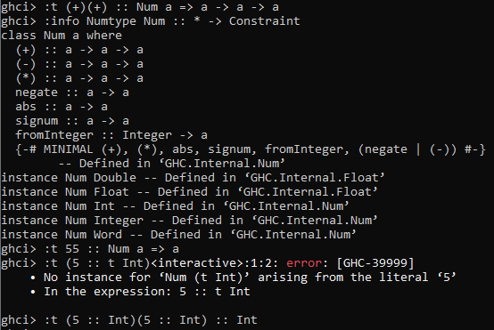

# Practica 3

### Objetivo
El objetivo de esta práctica fue aprender a definir funciones en Haskell que trabajan con tipos de datos propios y con listas, usando listas por comprensión para filtrar y contar elementos, y a crear, importar y utilizar módulos para reutilizar funciones entre archivos.

Tardé aproximadamente 4 horas de trabajo continuo en finalizar esta práctica; el ejercicio número dos me pareció el más complejo, aunque el uso de módulos también fue bastante interesante.

### Ejercicio 1
Num es una clase de tipos, un conjunto que soportan operaciones numéricas. Int es un tipo concreto, enteros de precisión fija, que pueden desbordarse. Int es una instancia de Num.

